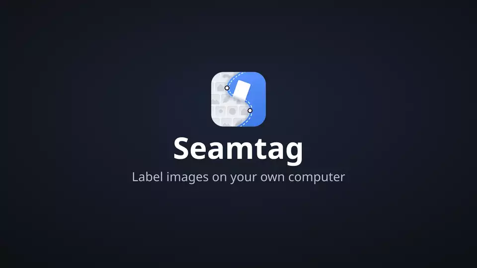
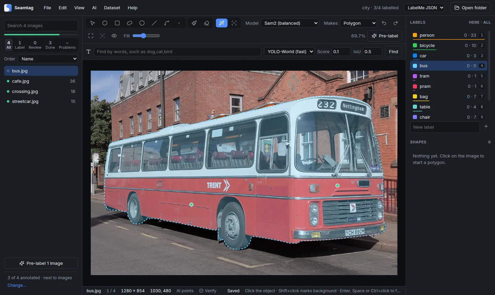
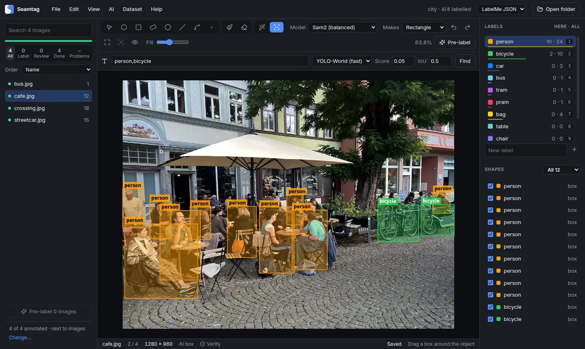
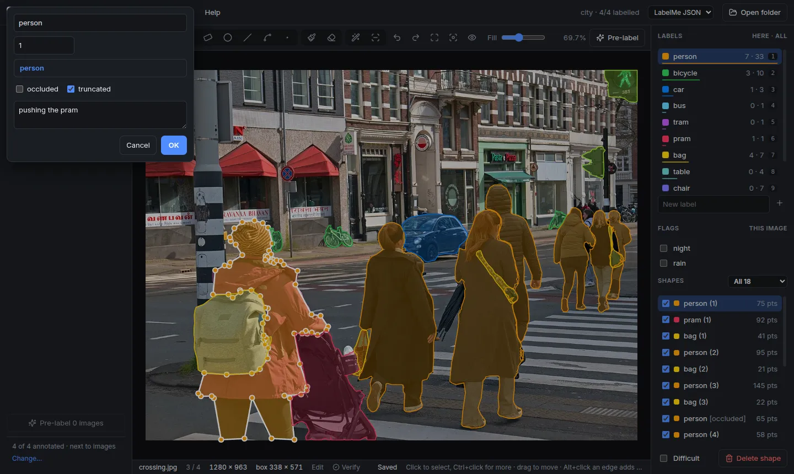
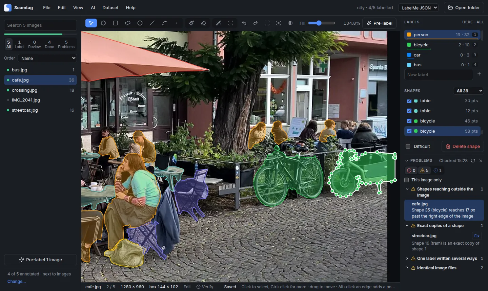
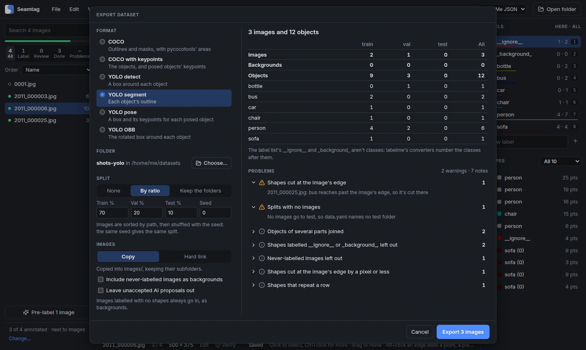

<p align="center">
  
</p>

<h1 align="center">Seamtag</h1>

<p align="center"><b>Label images in LabelMe, Pascal VOC, YOLO or CreateML format, with polygons, rectangles, rotated boxes, circles, lines and points, a brush and eraser, AI that finds objects from a click, a box or words, and review of a model's proposals. Check a whole folder's labels, and export it to COCO or Ultralytics YOLO, or import from them. For Windows, macOS and Linux.</b></p>

<p align="center">
  <a href="https://github.com/jakhon37/Seamtag/actions/workflows/ci.yml"></a>
  <a href="LICENSE"></a>
</p>



<sub>The app at work on four CC0 street photos; the waits for the AI are shortened.</sub>

Seamtag is a desktop app for labelling images. Each image's labels are saved in a file beside it, as LabelMe JSON, Pascal VOC, YOLO or CreateML, so a folder labelled in labelme or LabelImg opens as it is, and they open Seamtag's files too. Everything runs on your computer: images, labels and AI models never leave it.

## What it does

**Drawing and editing.** Polygons, rectangles, rotated boxes, circles, lines, line strips and points: click the first point to close, Shift for a square, lines stop at the image edge unless `canvas.allow_out_of_bounds_points` lets them past. A rotated box takes two clicks along one side and a third for its width; dragging a corner keeps it square, and the handles on its sides turn it. Edit labels in the label dialog (completion, flags per label pattern, group ID, description, and `--validate-label exact`), tick image flags, hide or reorder shapes, copy and paste them between images, lock them, merge polygons or masks of one label, add and remove points (Alt+click, Add point to edge on the right-click menu, or `Ctrl+M` for several along an edge), keep the previous image's shapes, and adjust brightness and contrast. `Ctrl`+arrow selects the next shape that way, and Fit to selection keeps the selected shapes in view.

**Pascal VOC, YOLO and CreateML.** Save labels as Pascal VOC (`name.xml`), YOLO (`name.txt`, with the class names in `classes.txt`) or CreateML (`name.json`) instead of LabelMe JSON, byte for byte as LabelImg writes them. Pick the format in the top bar or under File → Save format. An image keeps the format of the label file it has, and new label files take the format last used. Switching saves the image in the new format and moves its old file to the trash, so each image has one label file; if the image already has labels in the new format, those open instead, and nothing is converted. These formats hold boxes, so other shapes become the box around them, points are left out (a pose keeps its box), and the AI tools make boxes. Pre-labelling keeps its proposals in LabelMe JSON, so it works in that format.

**Verified images and box tools.** Tap `Space` to mark an image verified: the background turns green, the file list shows it, and Pascal VOC and CreateML files keep it. Mark boxes difficult, as Pascal VOC records it. Boxes are drawn square with Shift or Ctrl held, or always with Draw squares; any of the four corners can be dragged, and the status bar gives the size of the box being drawn or pointed at. Show labels on the boxes, copy the previous image's boxes, read an annotation file onto the image, show one label's boxes at a time, delete an image to the trash, and right-drag a box to copy or move it. Single class mode labels each new box with the label picked in the Labels list; turned off, each box asks. Advanced mode keeps a tool on; turned off, the tool goes back to editing after each shape. Boxes can have their own line and fill colours.

**AI points, AI box and the text prompt.** Click an object, or drag a box around it, and the model outlines it; Shift+click marks background. What it finds becomes the shape picked beside the tool: polygons (one for each part of the object, grouped), a mask, a rectangle, a circle or a rotated box. Repeats of one object are dropped, and with `ai.suppress_existing_shape_matches` so are objects already drawn. The text prompt takes words, such as `dog,cat`, and boxes everything they name with YOLO-World, each box labelled with its word and score. The models are EfficientSAM in two sizes, SAM2 in three, and YOLO-World, run as ONNX files, and RTMPose in two for AI pose (below). Each is downloaded once, when you agree, into `~/.cache/osam`, the folder labelme keeps its models in too, so a model either app has downloaded is there for the other; AI → AI models lists them, with their sizes and licences, and downloads or deletes them. SAM and SAM 3 aren't offered: their image encoders need blocks of memory larger than Electron allows.





**Keypoints and poses.** The Pose tool (`K`) draws a person, or anything else with keypoints, as a box and its named points: drag the box, then click each keypoint as you're asked for it ("5/17 left shoulder"), Shift+click one that's hidden, press `X` to skip one the photo doesn't show, and `Enter` when you're done. Lines join the points, with the left side, the right side and the middle each in their own colour, so a left-right mix-up shows, and hidden points are drawn hollow. A pose moves, copies and deletes as one, and folds into one row in the Shapes list ("person (1) · 15/17") that opens to its keypoints, missing ones included, which a click places. `Q` hides or shows a point, `M` swaps left and right, `Shift+M` mirrors a pose in its box, and `N` and `Shift+N` step through its keypoints. AI pose (`Shift+K`) finds the keypoints of the person in a box you drag, or with Pose every person, of each person in the image without keypoints yet, a group's shapes of the class being one person, with RTMPose: RTMPose-m, or RTMPose-l for more accuracy, downloaded from OpenMMLab when you agree. On an image with no person drawn, YOLO-World finds them first. Points it scores below `ai.pose_score` (0.3) are left out, and so is a pose with fewer than 5 points left; a pose is accepted or rejected as one, and an edit to any of its points accepts it. COCO's 17-point person is built in; Dataset → Keypoints… gives the folder its own keypoints file (`.myseg/keypoints.yaml`, X-AnyLabeling's pose file with Seamtag's lines and left-right pairs), chosen or made from the folder's poses. The label files are as before: a box and points sharing a group ID, each point labelled with its keypoint's name and a hidden one marked difficult, as X-AnyLabeling writes them and the COCO and YOLO pose exports read them.

**Pre-label with your own model.** Train one in [Seamline](https://github.com/jakhon37/Seamline) on the same folder and choose Export for Seamtag, and it's listed under AI → Model for pre-labelling; any other segmentation model exported to ONNX works too. It proposes shapes for every unlabelled image, each with a score. Proposals stay dashed until you accept them: `W` accepts, `S` rejects, `Tab` skips, and the list can put the least certain images first.

**Brush and eraser.** Paint a class, and shapes of that class you touch join it. Erase from one shape or everything under the stroke, splitting shapes or cutting holes.

**Big images.** Large and TIFF images open from a tile pyramid that libvips builds once, so only the tiles in view load: a 6050 × 12300 TIFF opens again in under a second, and zoom goes to 5000%.

**Labels that are hard to lose.** Saves go through one queue to a temporary file and then into place. A label file that can't be read is shown read-only and never written over, and closing the window saves first, or asks when saving isn't automatic. A label file another app, such as Seamline, changed after Seamtag read it is never written over or trashed either: Seamtag reloads it and says so.



**Check a folder's labels.** Dataset → Check labels reads every label file in the folder and lists what it finds in a Problems panel under the shapes. As errors and warnings: label files or images that can't be read, label files that give another image size, name another image, have no image or serve several images, masks that can't be read, shapes with no label, the wrong number of points or no area, repeated points, polygons that cross themselves, shapes reaching outside the image, exact and near copies, one label written several ways (`Cat` and `cat`) or missing from the label list, AI proposals not yet accepted, and identical images; and for poses, keypoints outside their box, repeated or not the class's, with no group or no box, and, as a note, a likely left-right swap. As notes, hidden until asked for: images never labelled, labelled with no shapes or not verified, and labels in the list that no shape uses. That's 29 checks in all. Clicking a problem opens its image with the shape selected. Repeated points, exact copies and boxes past the image's edge have a Fix, undone like any edit, and a label can be renamed in every label file of the folder, from the Problems panel or Statistics, with the old files sent to the trash. An image is checked again as it's saved, and the image list can show only the images with an error or a warning. Dataset → Statistics counts images by state, objects and images by label with each label's shapes by type, objects per image, object sizes as COCO ranges them at full size and at a training size, image sizes, and for poses how often each keypoint is seen, hidden or not labelled, and saves the tables as CSV.



**COCO and YOLO datasets.** File → Export dataset writes the folder as COCO (objects, or objects with keypoints) or Ultralytics YOLO (detect, segment, pose or rotated boxes, with its `data.yaml`): whole, split by ratio with a seed, or split as its folders already are, with the images copied, hard-linked or, for COCO, left where they are. The pose formats take the folder's keypoints file, or COCO's person when it has none. Everything is checked before anything is written, including what each format can't hold, and the dataset appears in its folder only once it's complete. File → Import dataset reads a COCO file or a YOLO dataset (Ultralytics', Roboflow's, CVAT's or X-AnyLabeling's layout) into each image's own label file, as LabelMe JSON whatever the save format. Images are matched by their path, or by a file name only one image on each side has, and never guessed: a name that fits several images is listed and left out. Images that already have labels are skipped, added to or replaced; a replaced file, or a Pascal VOC, YOLO or CreateML file added to, goes to the trash. The image's own label file stays the one you work on; datasets are made from it and read into it.



## Install

Download the installer for your system from [Releases](https://github.com/jakhon37/Seamtag/releases).

| System | File | Notes |
|---|---|---|
| Windows 10 and 11 | `Seamtag-…-win-x64.exe` | Not code-signed yet: on the SmartScreen warning, choose More info, then Run anyway. |
| macOS on Apple silicon | `Seamtag-…-mac-arm64.dmg` | Not notarised yet: right-click the app and choose Open the first time, or run `xattr -cr "/Applications/Seamtag.app"`. |
| macOS on Intel | `Seamtag-…-mac-x64.dmg` | As above. |
| Linux | `Seamtag-…-linux-amd64.deb` | `sudo apt install ./Seamtag-*.deb` adds a `seamtag` command, and on Ubuntu 24.04 and later the AppArmor profile Chromium's sandbox needs. |
| Linux, any distribution | `Seamtag-…-linux-x86_64.AppImage` | `chmod +x` it and run it. On Ubuntu the .deb is simpler: an AppImage can't add that profile, so from 24.04 it needs `--no-sandbox`, and it needs `sudo apt install libfuse2t64` (`libfuse2` on 22.04). |

To build it yourself you need Node 22:

```bash
git clone https://github.com/jakhon37/Seamtag.git
cd Seamtag
npm ci
npm run dev
```

`npm run dist` builds the installer for the system you're on, into `release/`.

## Use

Open a folder of images: labels are saved beside each image as `name.json` (LabelMe JSON), or in the format picked in the top bar. Images in subfolders are listed too. The command line takes labelme's options:

```bash
seamtag images/ --labels labels.txt --flags night,blurry --label-flags '{person: [occluded]}' -O labels/
```

LabelImg's command line works too: a folder of images, a file of classes, and a folder for the labels.

```bash
seamtag images/ predefined_classes.txt annotations/
```

| Option | |
|---|---|
| `--labels LIST\|FILE` | Labels to offer, comma separated or one per line in a file |
| `--flags LIST\|FILE` | Flags for each image |
| `--label-flags YAML\|FILE` | Flags for shapes whose label matches a pattern |
| `--validate-label exact` | Only allow listed labels |
| `-O`, `--output DIR\|FILE.json` | Save label files somewhere else |
| `--with-image-data` | Put the image in each label file |
| `--no-auto-save` | Don't save automatically |
| `--keep-prev` | Give an image with no labels the previous image's shapes |
| `--no-sort-labels` | Keep labels in the order given |
| `--epsilon N` | How close, in screen pixels, counts as on a point or an edge |
| `--config FILE\|YAML` | A config file, such as your `~/.labelmerc`, or YAML overrides; `--config '{label_format: yolo}'` saves new labels as YOLO |

labelme 5's spellings work too: `--nodata`, `--autosave`, `--nosortlabels`, `--labelflags` and `--validatelabel`.

Seamtag keeps one window. Started again while it's open, as Seamline's Label in Seamtag starts it, it brings that window forward and opens the image or folder there. It saves unsaved work first, or asks about it when saving by hand, and stops pre-labelling for another folder only if you agree. While a dialog or menu is open or a shape is being drawn, or when the image or folder isn't there, it opens nothing and says why, and you can start it again. A second start's options other than the image, folder and `-O` are left out: they take effect when Seamtag starts.

Started on an image in a subfolder of a Seamline project, one with `.myseg/project.json` in a folder above, Seamtag opens the whole project on that image, as Seamline lists it, whether it starts then or is open already. Open recent then lists the project, which opens on that image. A start with no file opens the last folder or file opened in the window, so after such a start while Seamtag was open, it opens the project on that image too. File → Open and a dropped image open the image's own folder, and are remembered that way.

Settings live in `~/.seamtagrc`, which takes labelme's keys, so a `~/.labelmerc` can be copied in as it is. File → Open config file opens it. [docs/config.md](docs/config.md) lists every key, including the shortcuts.

### Keys

| Key | Action |
|---|---|
| `P` `R` `V` | Polygon, rectangle, edit (`Ctrl+Shift+V`, `Ctrl+Shift+B` and `Ctrl+Shift+C` work too, and `Ctrl+J` for edit) |
| `B` `E`, `[` `]` | Brush, eraser, smaller and larger |
| `K`, `Shift+K` | Pose, AI pose; while placing a pose, Shift+click for a hidden keypoint, `X` to skip one, `Backspace` to go back, `Enter` to finish |
| `Q`, `M`, `Shift+M`, `N` `Shift+N` | Hide or show a keypoint; swap a pose's left and right; mirror it in its box; next and previous keypoint |
| `1`-`9` | Pick a label, or relabel the selected shapes |
| `A` `D` | Previous and next image; with `Ctrl+Shift`, copy this image's shapes over |
| `W` `S` `Tab`, `Shift+W` | Accept, reject or skip an AI proposal (`Tab` with the image focused); accept all here and move on |
| `Enter`, `Space`, double-click | Finish a polygon, line strip or AI points shape |
| `Alt`+click | Add a point on an edge, or remove one |
| `Ctrl+M`, `Ctrl+Shift+M` | Add several points along an edge; merge selected polygons, or masks of one label |
| `Ctrl+Z`, `Ctrl+Shift+Z` | Undo (a point while drawing), redo |
| `Space` | When nothing is being drawn, a tap marks the image verified, or not; held while dragging, it pans |
| Shift or `Ctrl` while drawing a box, `Ctrl+Shift+R` | A square box; Draw squares on or off |
| `Ctrl+Shift+L`, `Ctrl+Shift+F`, `Ctrl`+arrow | Lock or unlock shapes; fit the view to the selection; select the next shape that way |
| `Ctrl+Shift+P`, `Ctrl+H`, `Ctrl+A` | Labels on shapes; hide and show every shape |
| `Ctrl+E`, `Ctrl+L` | Edit the label; the colour boxes are drawn in |
| `Ctrl+R`, `Ctrl+Shift+O`, `Ctrl+Shift+Delete` | Change the output folder; read an annotation file onto this image; delete the image |
| Right drag on a shape | Copy or move it |
| Wheel, `Space`+drag, `0` | Zoom, pan, fit |

Help → Keyboard shortcuts lists them all. A few keys do other jobs here than in LabelImg (`W`, `Ctrl+V`, `Ctrl+Y`, `Ctrl+=`, `Ctrl+Shift+D`, `Ctrl+Shift+A`, `Ctrl+Shift+L`, `Ctrl+Shift+F`); [docs/config.md](docs/config.md#labelimgs-keys) has the lines that give them LabelImg's jobs. On a Mac, `Ctrl` is Command.

### Pre-labelling models

[Seamline](https://github.com/jakhon37/Seamline) trains in the folder it labels. Its Export for Seamtag, on its Train page, writes a run's model as `.myseg/runs/<run>/model.onnx`, with `model.json` beside it; this needs a Seamline that has that button. AI → Model for pre-labelling lists every run exported so, newest first, by its name, architecture, encoder and best IoU, and ticks the one pre-labelling uses. Newest run, at the top, is ticked until you choose a model for the folder; while it is, pre-labelling takes the newest run the folder has when it starts, so a run exported since is used. A model chosen in this menu, or with AI → Choose a model…, which opens in the folder's `.myseg/runs` and shows hidden files, is kept for that folder, even when newer runs come, until you choose Newest run again. A folder with no runs takes the model last picked with Choose a model…, and a run that another folder exported says which folder. The list is read again whenever Seamtag's window comes back into focus, so a run exported meanwhile shows up.

Seamline and Seamtag can be open on the same folder at once. When Seamtag's window comes back into focus, it first reloads the image on screen if another app changed its labels and nothing in Seamtag is unsaved. Then its image list picks up images added or removed and label files changed, and its label list picks up classes added, deleted or recoloured in `.myseg/project.json`. Seamtag never writes over or trashes a label file that another app changed after Seamtag read it, even if the file kept its size and time: it reloads the labels, counts them in its lists at once and says so until another image is on screen, and a change made in Seamtag meanwhile isn't saved. Saving by hand (`--no-auto-save`), it warns as soon as its window comes back, before saving drops anything. The class list in `.myseg/project.json` is what Seamline trains, one model output for each class. Adding a label in Seamtag adds that label alone, and giving a label a colour changes that label alone, adding it if it isn't a class yet. Renaming a label across the folder renames its class too, in its place and with its colour, once a label file has the new name. If the new name is a class already, both classes stay as they are, the old one empty, since joining them would change the model's outputs. Labels that come only from the config or the label files stay out of the class list, though Seamtag's label list shows them all. In a folder with no class list yet, Seamtag starts one as Seamline would, from the labels of the folder's shapes that have an area, then adds or recolours that label. Classes the other app added or deleted there since are kept as it left them, and so are the file's other keys. Starting Seamtag while it's open, as Seamline's Label in Seamtag does, brings its window forward and opens that image or folder there.

Any other ONNX model that takes an image as `[1, 3, H, W]` and returns raw scores per class as `[1, C, H, W]`, with background as class 0, works too: pick it with AI → Choose a model…. Seamtag applies the softmax itself, so a model that ends in one gives flattened scores. A JSON file beside the model with the same name says how to use it, as Seamline's `model.json` does; every key is optional:

```json
{ "classes": ["scratch", "dent"], "mean": [0, 0, 0], "std": [1, 1, 1], "tile": 1024, "input_size": [512, 512] }
```

A model Seamline exported finds the same pixels in both apps, bar the odd one where onnxruntime and PyTorch round differently, since Seamtag resizes its tiles as Seamline does (see below). So the two apps propose the same shapes, with the same scores. Each part a class covers becomes a polygon through the centres of its outer pixels, as Seamline's own pre-labelling makes it, so an accepted shape trains on the pixels the model found; each app draws the outline its own way, so the points differ a little. Parts of a class that touch only at a corner are the exception: Seamtag outlines each on its own, where Seamline makes one shape of them. Parts smaller than `prelabel.min_area` (25 by default, measured the same way) are left out, and so is a part inside another part's hole, which the other's shape covers. An image the model finds nothing on gets no label file, as in Seamline, so it stays to label and the next model is tried on it; an image with an older model's proposals keeps them. Pre-label on one image says when the model found nothing. A label file with no shapes says someone cleared the image, so Pre-label N images leaves it out, in both apps. Saving automatically, Seamtag writes no label file for an image that has none while it has no shapes and no flags: a shape drawn and then undone or deleted leaves no file, and the file saved meanwhile goes again, unless it was saved by hand or another app changed it. Saving by hand (Save, `Ctrl+S`, or Save when asked) writes the empty file, as labelme does.

Pixels are scaled to 0-1, then each channel has `mean` taken away and is divided by `std`. Seamline's runs take pixels scaled to 0-1 and nothing more, so their `model.json` says mean 0 and std 1; a model without these keys gets ImageNet's mean `[0.485, 0.456, 0.406]` and std `[0.229, 0.224, 0.225]`, which many models trained elsewhere expect. Without `classes`, the label list names the classes, in order. Images bigger than `tile` go through tile by tile, each tile resized to `input_size` (height, width; without it, the model's own fixed size, or 512 × 512) with OpenCV's bilinear, as Seamline's pre-labelling resizes it, and its classes and confidence back with OpenCV's nearest and bilinear. Each shape's score is the model's mean confidence inside it, useful for ranking rather than as a probability.

## Compatibility

Label files go both ways with [labelme](https://github.com/wkentaro/labelme) and [LabelImg](https://github.com/HumanSignal/labelImg), and datasets with COCO and Ultralytics YOLO tools; each way is tested:

- Saving a file that labelme 5 wrote gives back the same bytes, including Python's float format and key order.
- Every `.json` in labelme's examples and test data opens. The tests fetch labelme's example files from its repository, at a fixed commit, and check each against its hash.
- In CI, labelme 7.9.1 and 5.8.1 load the files this app writes with each drawing tool and turn every shape into pixels with `shapes_to_label`, as labelme's export scripts do. CI has no SAM models; run locally with one, AI mask shapes pass the same check.
- On the test photo, AI masks are the same as osam's, pixel for pixel, for EfficientSAM and SAM2, and YOLO-World finds the same boxes with the same scores as labelme 7.9.1. That needed Pillow's bilinear resize ported exactly, which a test checks against Pillow 13.
- Unit tests compare what AI results become with what labelme 7.9.1's own code makes of the same test masks: polygons at each detail, circles, rotated boxes, the removal of repeats and of objects already drawn, osam's non-maximum suppression, and CLIP's tokens for text prompts.
- labelme 7.9.1's whole default config loads with every key known, and labelme 5.8.1's migrates as labelme 7 migrates it.
- Pascal VOC, YOLO and CreateML files are written as LabelImg writes them, byte for byte: down to Python's rounding of halves, its number format, and LabelImg's rule that saved boxes are whole pixels starting from 1. Unit tests compare them with files LabelImg 1.8.6 and its master branch wrote, and read those files back as LabelImg reads them. One difference is on purpose: a byte order mark at the start of `classes.txt`, which some editors write, isn't kept in the first class's name, as Seamline reads it too.
- In CI, LabelImg 1.8.6 and its master branch read every Pascal VOC, YOLO and CreateML file the app writes, and write the same bytes for the same boxes. The one difference is CreateML's verified mark, which master writes and 1.8.6 leaves out.
- COCO's numbers, the runs of its masks, their areas and boxes, are ported from pycocotools 2.0.11's C code and compared with it on 251 masks, polygons, boxes, merges and runs, to the pixel and the byte. Objects are made from the label files' shapes as labelme 7.9.1's `labelme2coco` makes them. In CI, pycocotools loads every COCO file the app writes, from the unit tests and from the Export dataset window, decodes each mask and scores the export against itself: AP 1.0 for boxes, masks and keypoints.
- In CI, Ultralytics 8.4.211's own label check (`verify_image_label`) accepts every YOLO dataset the app writes, for all four tasks, and its YAML reader gives back the class names Seamtag wrote. An object of several parts becomes one row, joined as Ultralytics' `merge_multi_segment` joins COCO's. Ultralytics' code is fetched for the test, checked against its hash, and isn't kept here.
- Import is tested on what `labelme2coco` writes, on pycocotools' compressed masks and CVAT's COCO (lists of runs, rotated boxes), and on Ultralytics', Roboflow's, CVAT's and X-AnyLabeling's YOLO layouts.

## How it's built

An Electron app in TypeScript. The main process reads and writes files, builds tile pyramids with libvips (through sharp), and runs ONNX models with onnxruntime, so no Python is needed; pre-labelling outlines its shapes in a worker thread, which keeps the main process free. The window is React, drawing on a canvas; LabelMe JSON lives in one shared module, [`src/shared/labelfile.ts`](src/shared/labelfile.ts), and Pascal VOC, YOLO and CreateML in [`src/shared/formats.ts`](src/shared/formats.ts). The AI pipeline (masks to shapes, the removal of repeats, non-maximum suppression, CLIP's tokenizer) is in [`src/main`](src/main) beside the models. COCO with its mask runs, and Ultralytics' YOLO, are in [`src/shared/coco.ts`](src/shared/coco.ts), [`rle.ts`](src/shared/rle.ts) and [`ultralytics.ts`](src/shared/ultralytics.ts), and the folder's checks and statistics in [`checks.ts`](src/shared/checks.ts) and [`stats.ts`](src/shared/stats.ts); the main process reads a whole folder's labels with a cache, and reads COCO files in a worker of their own. Unit tests (Vitest) cover the formats, config, geometry, the AI pipeline and the resizes; end-to-end tests (Playwright) drive the real app on Windows, macOS and Linux, each launch with a home folder and profile of its own. Installers are built by electron-builder on each system.

## License

[GPL-3.0-only](LICENSE). Copyright © 2026 Jakhongir Nodirov.

Code from other projects is included under their own licences, listed in [NOTICE.md](NOTICE.md).
